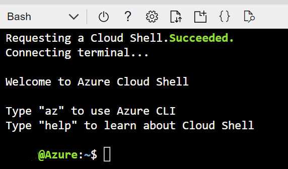
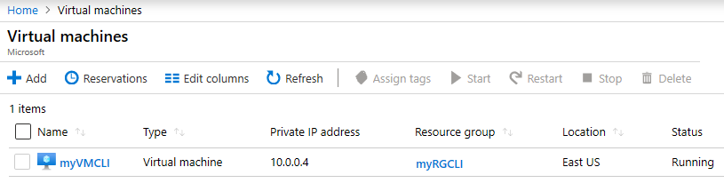

# Create a VM with the Azure CLI

## Overview

In this lab, you will create a new virtual machine in Azure using the command line and the Azure cloud shell.



### Learning Objectives

In this lab, you will learn the basics of using the Azure CLI and cloud shell.

You will:

- Provision a resource group and a virtual machine

### Naming Conventions

In this exercise, you will create a new resource group from the command line. Please note the instructions for creating that resource group. To ensure uniqueness, you will be required to use your alias in the resource group name.

### Lab Execution Notes and Warnings

#### Where To Do This Lab

This lab can be performed on your laptop/desktop. There are no code dependencies.

#### Lab Dependencies

 - __Locally installed tools:__ None.

 - __Previous lab dependencies:__ This lab has no previous dependencies.

 - __Lab code:__ None. This lab does not use any lab code.

## Create a VM with the CLI (10 mins)

In this lab, you will configure the Cloud Shell, use Azure CLI to create a resource group and virtual machine, and review Azure Advisor recommendations.

### Task 1: Configure the Cloud Shell 

In this task, you will configure Cloud Shell, then use Azure CLI to create a resource group and a virtual machine.  

1. Sign in to the [Azure portal](https://portal.azure.com).

    > __Note:__ 
    > These instructions presume that you have not previously used Cloud Shell. If you do not receive the prompts in steps 3 and 4, you have likely configured Cloud Shell already and should skip to Task 2.

2. From the Azure portal, open the **Azure Cloud Shell** by clicking on the icon in the top right of the Azure Portal.

    
   
3. In the Welcome to Azure Cloud Shell dialog, when prompted to select either **Bash** or **PowerShell**, feel free to select either as the Azure Command Line Interface (CLI) is available in both. 

4. A new window will open with the title **Getting started.** Select **Mount storage account** and, choose your FTE subscription, and click **Apply**.

5. In the **Mount storage account screen**, select **We will create a storage account for you**, and click next.

### Task 2: Use CLI to create a virtual machine

In this task, you will use Azure CLI to create a resource group and a virtual machine.

1. Ensure that the correct subscription is the default by entering the following command. 

    ```cli
    az account set --subscription "Visual Sudio Enterprise"
    ```

2. Create a resource group for this lab by entering the following command. Be sure to replace "alias" with your alias.

    ```cli
    az group create --location eastus --resource-group alias-clivm-rg
    ```

3. In Cloud Shell enter the command below and make sure that each line, except for the last one, is followed by the backslash (`\`) character if using Bash, or backtick (`) character if using PowerShell. If you type the whole command on the same line, do not use any backslash characters. Be sure to replace "alias" in the Resource Group name to be your alias.

    ```cli
    az vm create \
    --name myVMCLI \
    --resource-group alias-clivm-rg \
    --image Win2019Datacenter \
    --location EastUS \
    --admin-username azureuser \
    --admin-password Pa$$w0rd1234 \
    --public-ip-sku Standard \
    --size Standard_DC1s_v3
    ```
    
   > __Note:__ 
   > The command will take 2 to 3 minutes to complete. The command will create a virtual machine and various resources associated with it such as storage, networking and security resources. Do not continue to the next step until the virtual machine deployment is complete. 

1. In the Azure portal, search for **Virtual machines** and verify that **myVMCLI** is running.

    

### Task 3: Execute commands in the Cloud Shell

In this task, you will practice executing CLI commands from the Cloud Shell. 

1. From the Azure portal, open the **Azure Cloud Shell** by clicking on the icon in the top right of the Azure Portal.

3. Retrieve information about the virtual machine you provisioned, including name, resource group, location, and status. Notice the PowerState is **running.** Be sure to replace "alias" with your alias.

    ```cli
    az vm show --resource-group alias-clivm-rg --name myVMCLI --show-details --output table 
    ```

4. Stop the virtual machine. Notice the message that billing continues until the virtual machine is deallocated. Be sure to replace "alias" with your alias.

    ```cli
    az vm stop --resource-group alias-clivm-rg --name myVMCLI
    ```

5. Verify your virtual machine status. The PowerState should now be **stopped.** Be sure to replace "alias" with your alias.

    ```cli
    az vm show --resource-group alias-clivm-rg --name myVMCLI --show-details --output table 
    ```
6. When the command finishes running, in the browser window, close the Cloud Shell pane.

## Summary

Congratulations! You just created a virtual machine in Azure using the cloud shell.

In this lab, you learned the foundations of creating, configuring, and verifying a Windows-based virtual machine using the command line in the cloud shell.

You also learned a few additional commands in the cloud shell for managing virtual machines in Azure.

As discussed in the lectures, this is an example of utilizing an IaaS, or Infrastructure as a Service offering.
