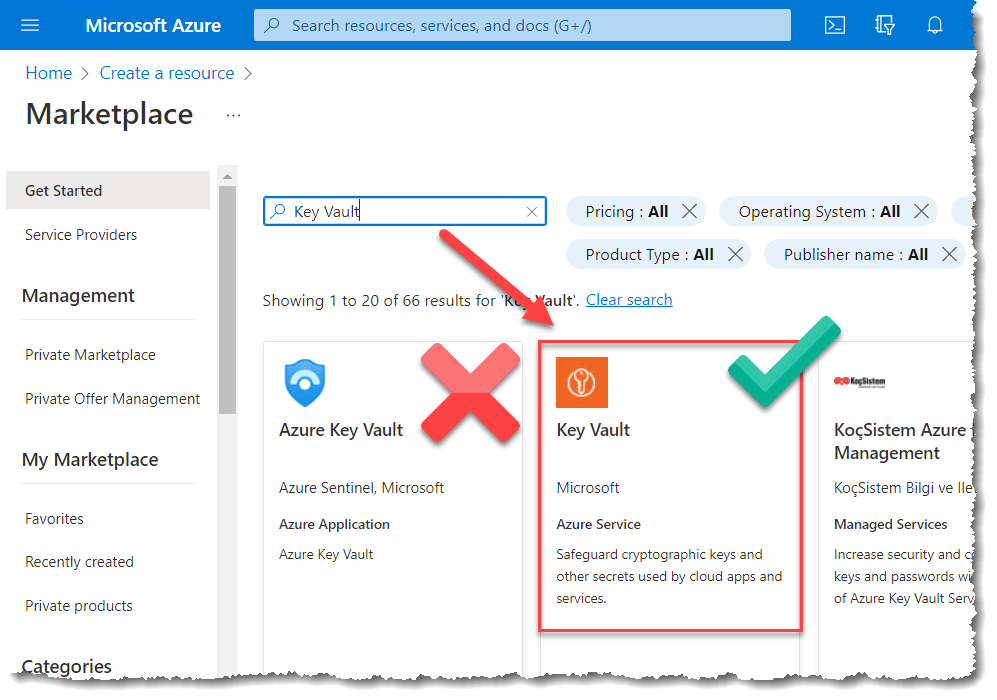
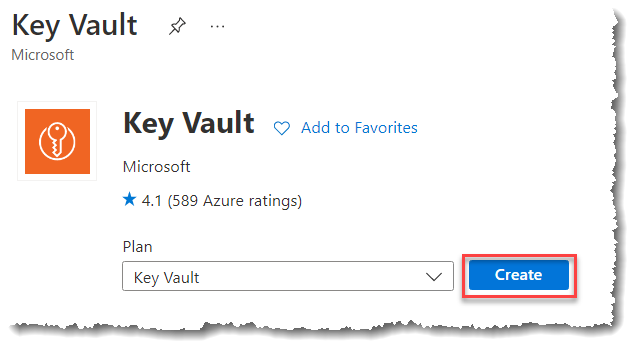
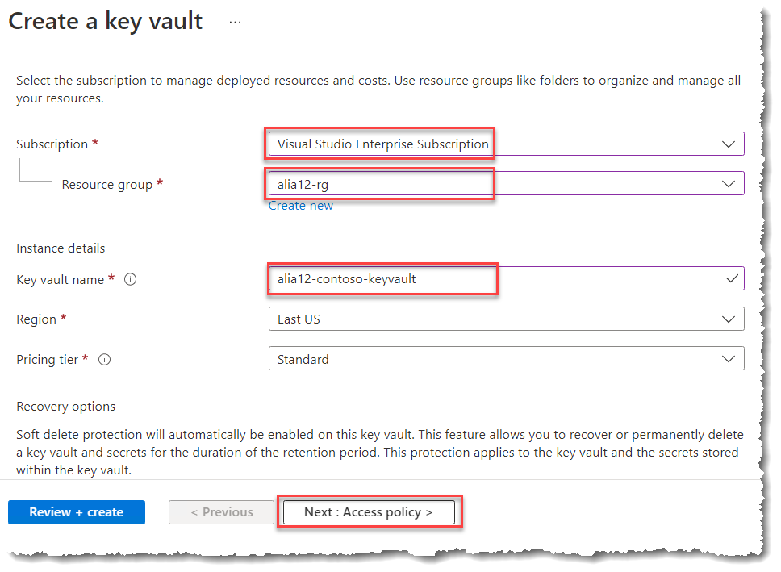
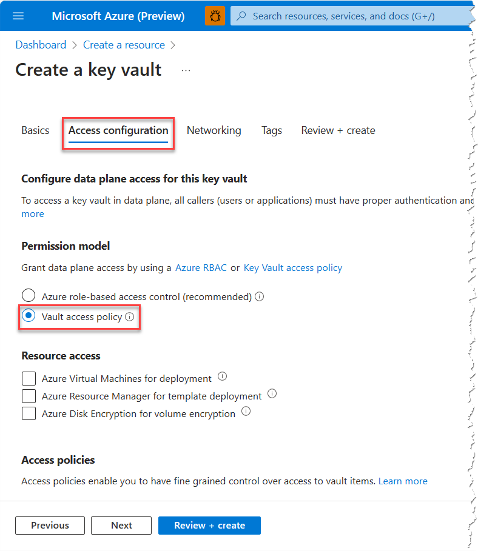
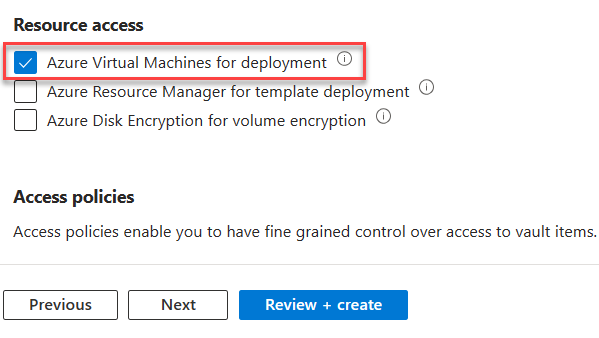
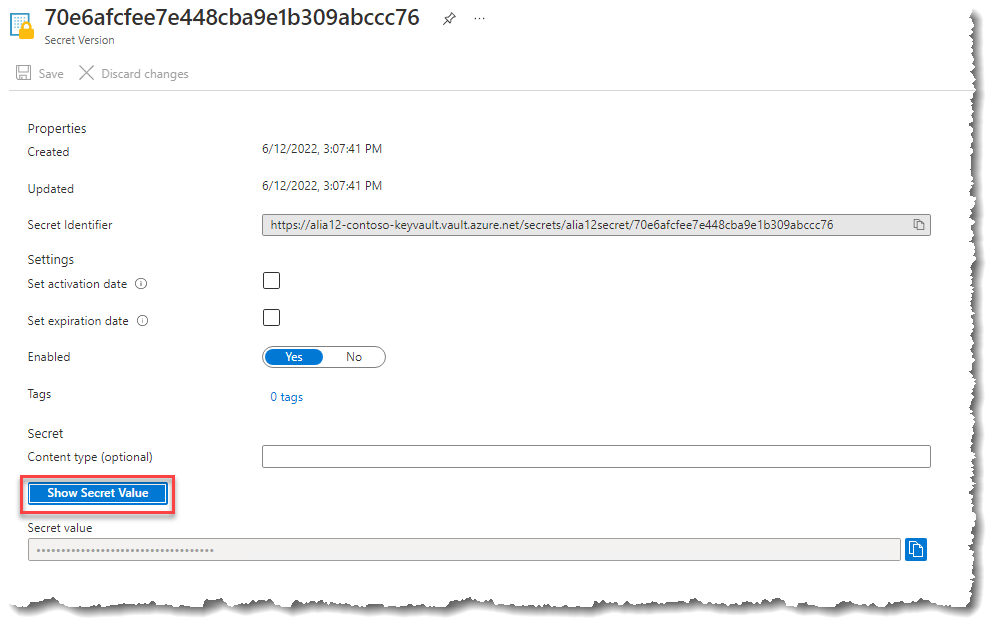
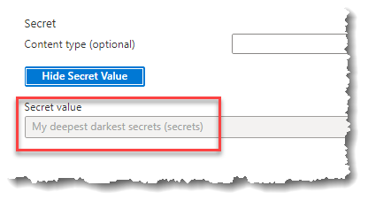
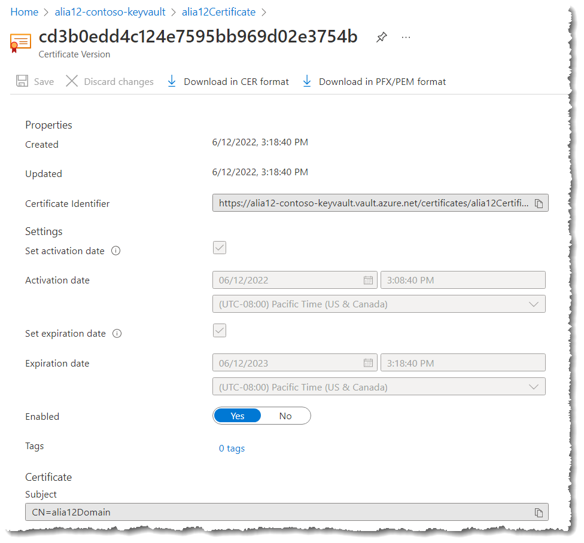
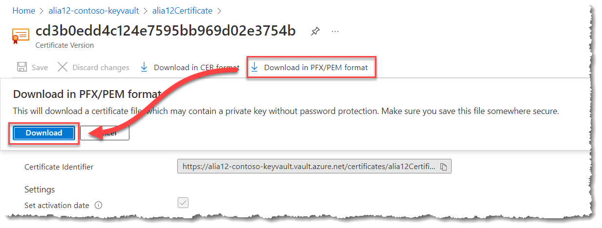

# Create Azure Key Vault

## Overview

In this lab, you will create a Key Vault resource in Azure and then learn to work with Azure Key Vault to securely create, store, retrieve and maintain secrets.

We will cover the management of both passwords (protected string values) and certificates.

### Lab Execution Notes and Warnings

> **NOTE:** In this lab you'll be asked to choose a personal secret to save into Key Vault. In the case that you are using a subscription shared with others, please pick something that you don't mind sharing. It can be a phrase, a word, a sentence, a number or anything at all.

#### Where To Do This Lab

This lab can be performed on your laptop/desktop. No code is required to be downloaded to your laptop/desktop.

#### Lab Dependencies

 - __Locally installed tools:__ None. 

 - __Previous lab dependencies:__ This lab depends on the resource group you created in lab 0.

 - __Lab code:__ None. This lab does not use any lab code.

## Exercise 1: Creating an Azure Key Vault Resource

In this exercise you will create a new Azure Key Vault resource to act as a central secure repository for secrets.

Key Vault is a public service and this task uses the publicly available capabilities. Full details on these capabilities in KeyVault are available at <https://aka.ms/kvdocs>

### Task 1: Launch the Azure Management Portal

1. From your browser, navigate to <https://portal.azure.com>
    and authenticate with your __Personal Credentials__.

### Task 2: Create new Key Vault resource

1. In the Azure portal, select __Create a resource__.

1. Search for and then create a __Key Vault__ resource.

   > **NOTE:** There is a similarly named **Azure Key Vault** item in the marketplace which is actually a solution for Microsoft Sentinel to stream Key Vault diagnostic logs into Microsoft Sentinel. As a result, please ensure that you are selecting **Key Vault** and *NOT* **Azure Key Vault**.

   

1. In the **Plan** list, keep the default selection of **Key Vault**, and then select **Create**.

   

1. On the Create key vault blade, specify the following information (replace \<alias\> with the alias you have been using throughout the lab activities):
   - Subscription: __Visual Studio Enterprise Subscription__
   - Resource Group:  __\<alias\>-rg__
   - Key vault name: __\<alias\>-keyvault__
   - Region:  __East US__
   - Pricing tier: *Leave this as __Standard__*

      

1. Select __Next: Access policy__.

1. On the **Access policies** tab, under **Permission model**, select **Vault access policy**.

   

1. Select __Enable access to Azure Virtual Machines for deployment__. This option allows virtual machines to access the vault for secrets during deployment (e.g., when creating Service Fabric clusters).

   

1. Also on the Access policies tab, you will notice that your account has already been added to the access policy with full permissions.

1. Select __Review + create__, and then in the Create a key vault blade, select __Create__ leaving all other configuration options untouched.

1. You can now __minimize__ your browser window as Key Vault will start deploying.

## Exercise 2: Storing Secrets (string values) in Key Vault

In this exercise you will store and retrieve a simple password string in Azure Key Vault. There are a range of options for accessing key vault including PowerShell, a REST API and wrappers for .NET and node.js.

Key Vault is a public service and this task uses the publicly available capabilities. Full details on these capabilities in KeyVault are available at <https://aka.ms/kvdocs>

### Task 1: Launch the Azure Management Portal

1. From your browser, navigate to <https://portal.azure.com>
    and authenticate with your __Personal Credentials__.

### Task 2: Create and Store your secret

To add a secret to the vault, follow the steps:

1. Navigate to your new key vault in the Azure portal
1. On the Key Vault settings pages, select **Secrets**.
1. From the Toolbar, select **Generate/Import**.
1. On the **Create a secret** screen, choose the following values:
    - **Upload options**: Manual.
    - **Name**: \<Alias\>secret
    - **Value**: Type any value at all for the secret. This value will be stored encrypted in the cloud. Key Vault APIs accept and return secret values as strings.
    - Leave the other values with the default settings, and then select **Create**.

1. Once that you receive the message that the secret has been successfully created, **select** it from the list.

### Task 3: Retrieve a secret from Key Vault

1. Select the current version of the secret to see the details about the current secret version.

    > **NOTE:** For more information about secrets attributes, see [About Azure Key Vault secrets](https://docs.microsoft.com/en-us/azure/key-vault/secrets/about-secrets)

1. Select **Show Secret Value** to reveal the hidden secret value.

    

    

    > **NOTE:** You can also use __CLI__, or __PowerShell__ to retrieve previously created secret.

## Exercise 3: Creating & Storing Certificates in Key Vault

In this exercise you will create, store and retrieve a certificate in Azure Key Vault using the Key Vault Certificates capability.

The Certificates feature provides the enhancement over secrets. It provides capability of storing certificates as 'Certificates' objects where Key Vault understands that is a X.509 certificate and provides certain lifecycle monitoring around it, while still making the **private** key available via the **secrets** API. The enhancements are:

- Create the private key of the certificate inside Key Vault to ensure it always has an audit trail.
- Create a certificate manually (by creating a request and getting it signed by a CA), as a self-signed certificate or enroll for a certificate from SSLAdmin.
- Create the private key of the certificate outside Key Vault and import it into Key Vault.
- Auto renew certificate when the certificate reaches 80% of its lifetime

### Task 1: Launch the Azure Management Portal

1. From your browser, navigate to <https://portal.azure.com>, and authenticate with your __Personal Credentials__.

1. Navigate to your Azure Key Vault named `<alias>-contoso-keyvault`

    > **TIP:** You can type the name of the Key Vault into the search box at the top of the Azure portal to quickly navigate to the resource.

### Task 2: Add a certificate to Key Vault

To add a certificate to the vault, you just need to take a couple of additional steps. In this case, we add a self-signed certificate that could be used by an application. The certificate is called `<alias>Certificate`.

1. From the Key Vault's Overview page, select **Certificates**.
1. From the Toolbar, select **Generate/Import**.
1. On the **Create a certificate** screen, choose the following values:
    - **Method of Certificate Creation**: Generate
    - **Certificate Name**: \<alias\>Certificate
    - **Subject**: CN=\<alias\>Domain
    - Leave the other values to their defaults. (By default, if you don't specify anything special in Advanced policy, it'll be usable as a client auth certificate.)
1. Select **Create**.

1. Once that you receive the message that the certificate has been successfully created, **select** it from the list. You can then see some of the properties.

    > **NOTE:** You may have to refresh the listing every few moments until you see the certificate listed under the **Completed** heading.

1. Select the the current version of the certificate and review its properties.

    

### Task 3: Export certificate from Key Vault

1. Select "Download in PFX/PEM format" button, to download the certificate.

    

    > **NOTE**: While this allows you to export the certificate for use elsewhere, when you download using this option the file may include the **private** key, and the file itself is not password protected. Be mindful of this before downloading a certificate in this manner, so that you don't inadvertently expose the secret by e.g., downloading the file to a network share.

## Additional Information

### Azure Key Vault:

- [Internal Documentation on Secrets Management](https://aka.ms/kvssl)

- [Internal Introduction to KeyVault Certificates](https://aka.ms/AzureCertificateManagement)

- [Public Documentation](https://azure.microsoft.com/en-us/Documentation/services/key-vault/)

### Email Support

- General: [AzSecretSupport@microsoft.com](mailto:AzSecretSupport@microsoft.com)

- Azure Key Vault: [AzureKeyVault@microsoft.com](mailto:AzureKeyVault@microsoft.com)
